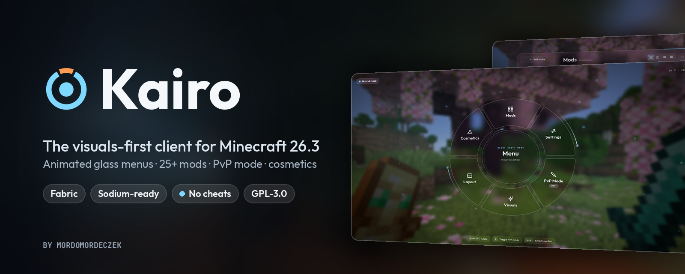
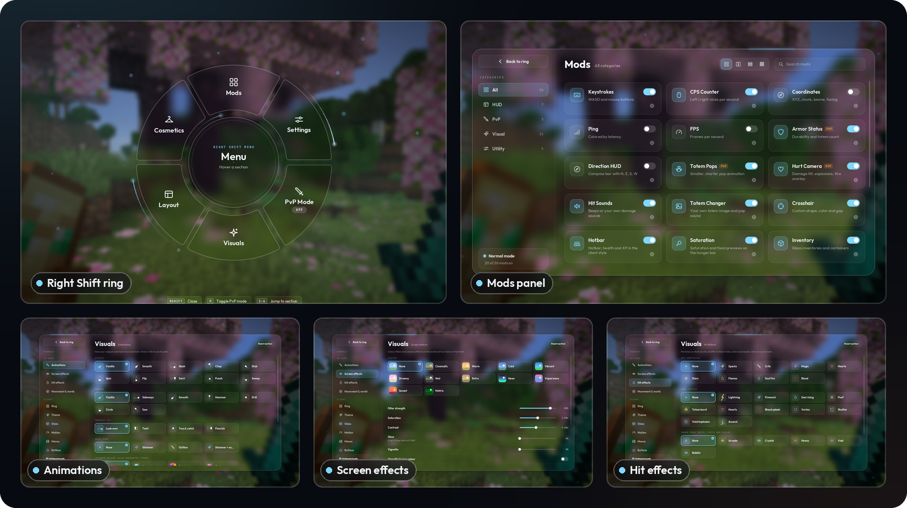
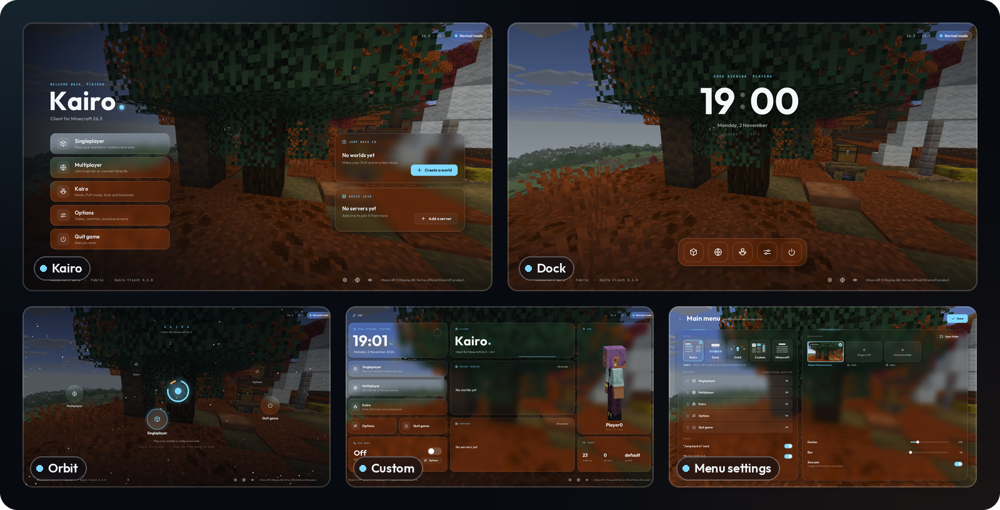
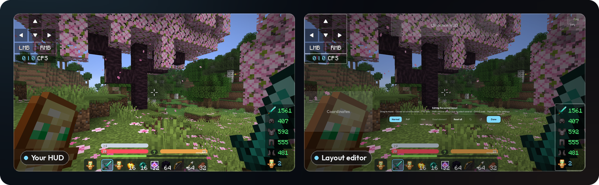
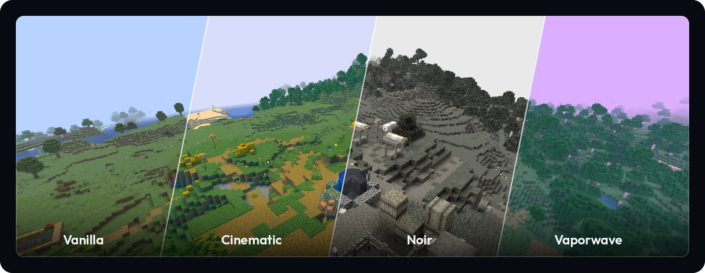
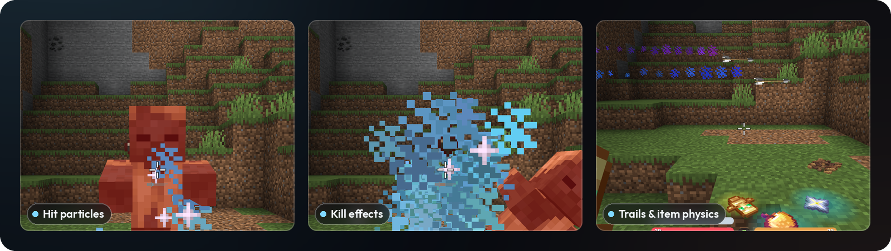
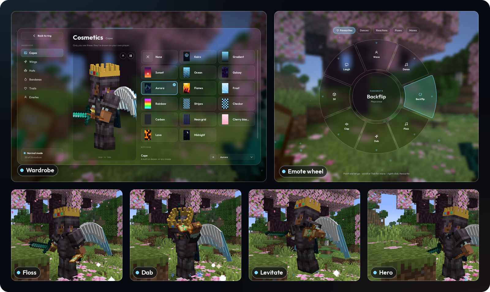

<p align="center">
  
</p>

<p align="center">
  <a href="https://github.com/MordoMordeczek/Kairo/releases/latest"></a>
  
  
  
  <a href="LICENSE"></a>
</p>

<p align="center">
  <b>Frosted glass menus, a HUD you drag into place, a PvP mode, cosmetics and emotes.</b><br>
  Everything is visual and client-side. No cheats, no automation, nothing extra sent to servers.
</p>

<p align="center">
  <a href="https://github.com/MordoMordeczek/Kairo/releases/latest"><b>Download</b></a> ·
  <a href="#-install"><b>Install</b></a> ·
  <a href="docs/FEATURES.md"><b>Feature guide</b></a> ·
  <a href="https://github.com/MordoMordeczek/kairo-void"><b>Kairo Void</b></a>
</p>

<br>

|  |  |  |
|:--|:--|:--|
| 🧊 **Glass everything**<br>Blurred, frosted panels and a breathing Right Shift ring, all animated. | ⚔️ **PvP mode**<br>One switch for calmer explosions, smaller totem pops, no hurt tilt and its own HUD layout. | 👤 **Only on your screen**<br>Capes, wings, hats and 37 emotes, drawn for you alone. No accounts, no telemetry. |

## ✦ The Right Shift menu

Press **Right Shift** and the world blurs behind a glass ring. Mods, visuals, settings, cosmetics and your HUD layout are one click away, and you choose which 3 to 8 segments the ring shows.

<p align="center"></p>

## ✦ Five main menus

Kairo replaces the title screen with one of five styles: **Kairo** (glass rows and cards), **Dock** (a big clock and a magnifying dock), **Orbit** (menu entries as planets on a tilted ring), **Custom** (your own home screen of widgets on a grid) or **Minecraft's own** title in the Kairo look. Any image, GIF or panorama can be the background.

<p align="center"></p>

## ✦ Your HUD, your way

Keystrokes, CPS, FPS, ping, coordinates, a compass and armor status. Drag them, resize them, multi-select, undo and redo in the layout editor. PvP mode gets a **separate layout**, and elements glide between the two when you flip it.

<p align="center"></p>

## ✦ Make it look like a trailer

11 colour filters, bloom, motion blur that only kicks in when you turn, film grain, vignette and cinema bars. Ten attack animations, seven mining animations and weapon inspect. Hit particles, kill effects, sound packs, projectile trails and item physics.

<p align="center"></p>
<p align="center"></p>

> [!TIP]
> **Share your look.** *Visuals → Share look → Copy my look* turns your whole style into one code a friend can paste. Keybinds and HUD positions never go in it.

## ✦ Cosmetics & emotes

16 capes (some animated, or use any image), 9 wings, 12 hats with fit sliders, bandanas and trails. **37 emotes** in four pages: hold **B**, point, let go. Only you see them.

<p align="center"></p>

## ✦ All the mods

<details>
<summary><b>Show the full list (25+)</b></summary>
<br>

| Mod | What it does |
|---|---|
| Keystrokes, CPS, FPS, Ping, Coordinates, Armor Status, Direction HUD | HUD elements you place with the layout editor |
| Zoom | Hold **C**, scroll to zoom further; smooth, with optional hand hiding |
| Fullbright | Raises the gamma value only. No Night Vision, no lighting changes |
| Crosshair | Cross, dot, circle, T or your own pixel grid; outline and cooldown styles |
| Waypoints | Markers with beams and a death point, saved per world and server (**M**) |
| Chat | Timestamps, stacked repeats, longer history, search, right-click to copy |
| Scrollable Tooltips | Scroll tooltips taller than the screen |
| Shulker Preview | See inside shulker boxes in the tooltip and above the hotbar |
| Hotbar | Glass hotbar, health, armor, hunger and XP bars in the client style |
| Saturation | Shows the hidden food values on the hunger bar |
| Block Outline | Colour, thickness, rainbow and a see-through fill |
| Inventory | Inventories and containers in the glass look |
| 3D Skins | Skin layers built from small cubes for real depth |
| Item Scale | Smaller or bigger held items, per hand |
| Totem Pops | Smaller, shorter pop animation and fewer particles |
| Hurt Camera | Damage tilt, explosion particles and the fire overlay |
| Hit Sounds | Built-in sounds, sound packs or your own files |
| Totem Changer | Any image or a recolour as your totem, plus your own pop sound |
| Screenshots | Copy, open or delete right after F2 |

Every mod has its own settings and an **In PvP mode** section. The [feature guide](docs/FEATURES.md) explains all of it.

</details>

## ✦ Kairo Void

<a href="https://github.com/MordoMordeczek/kairo-void"><b>Kairo Void</b></a> is the second edition, built from this same code: flat dark menus, and over-the-top combat and sky visuals (energy blades, impact shockwaves, ten atmospheres, crystal styles, a cosmic night sky). Install **one** of the two, not both.

## 📦 Install

1. Install [Fabric Loader](https://fabricmc.net/use/) for Minecraft Java **26.3**.
2. Put these in your `mods` folder:
   - [Fabric API](https://modrinth.com/mod/fabric-api) for 26.3
   - [Sodium](https://modrinth.com/mod/sodium) 0.9.x for 26.3 (required)
   - `kairo-0.1.0.jar` from [Releases](https://github.com/MordoMordeczek/Kairo/releases/latest)
3. Start the game. A short setup runs the first time. In game, press **Right Shift**.

Tested on Windows.

> [!WARNING]
> **Photosensitivity.** Kairo has flashing lights, bright bursts of colour, screen shakes and fast-moving effects. A very small number of people can have a seizure when they see flashing lights or patterns, even with no history of epilepsy. If you or anyone in your family has had seizures or epilepsy, talk to a doctor before playing, and stop right away if you feel dizzy or sick or notice blurred vision, twitches or confusion. The first-run setup lets you pick **Fewer flashes** and **Reduce motion**; both can be changed any time in *Visuals*.

## 🛡️ Fair play and privacy

- **No cheats.** Kairo only changes what your own screen draws and plays. No automation, no packet changes, no reach, no ESP.
- **No internet.** No accounts, no telemetry, no analytics. Settings, waypoints and your images and sounds stay in `config/kairo`.
- **Server rules still apply.** Some servers have rules about client mods (Fullbright or Zoom, for example). Check them before you play.

## 🔨 Build from source

You need a JDK (17 or newer) to start Gradle. The wrapper downloads Gradle and a Java 25 toolchain by itself.

```bash
./gradlew build          # both jars in build/libs/ (kairo and kairo-void)
./gradlew runClient      # dev client with Sodium, in ./run
./gradlew runVoidClient  # the same, as Kairo Void
```

On Windows use `gradlew.bat`. Project layout and the rest are in the [feature guide](docs/FEATURES.md#build).

## 🤖 Certified AI slop

Full disclosure: Kairo is **100% vibecoded**. I designed it, made the decisions and played it until it felt right; the AI wrote the code, the shaders, the generated sounds and this README (yes, this sentence too). Every line was read by a machine, and some of them by me.

If something breaks, it's a feature of the vibes. Open an issue anyway.

## 📄 License

Kairo is free software under the [GNU General Public License v3.0](LICENSE). Copyright © 2026 MordoMordeczek. The bundled fonts (Outfit, JetBrains Mono) are under the SIL Open Font License; see [THIRD_PARTY_NOTICES.md](THIRD_PARTY_NOTICES.md).

<sub>Not an official Minecraft product. Not approved by or associated with Mojang or Microsoft. Minecraft is a trademark of Mojang Synergies AB. Fabric and Sodium are separate projects with their own licences and are never bundled.</sub>
